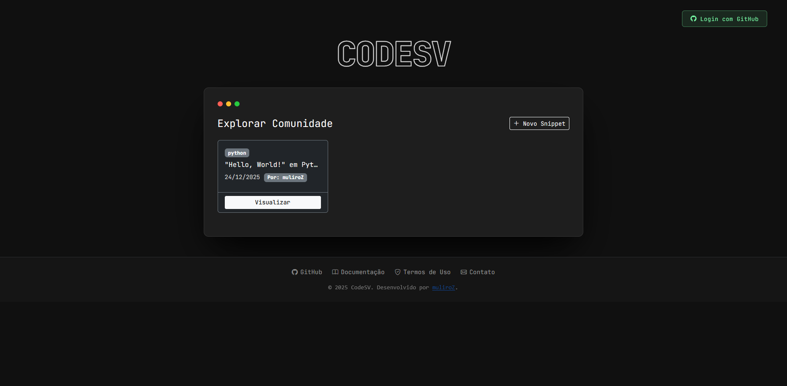
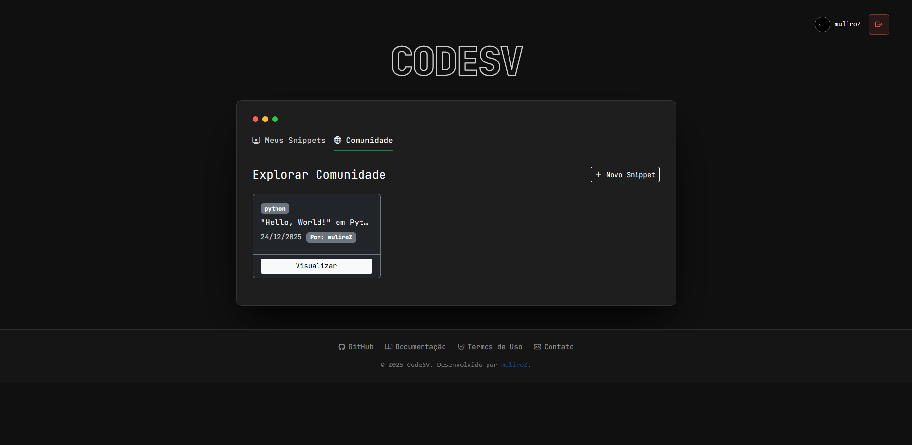
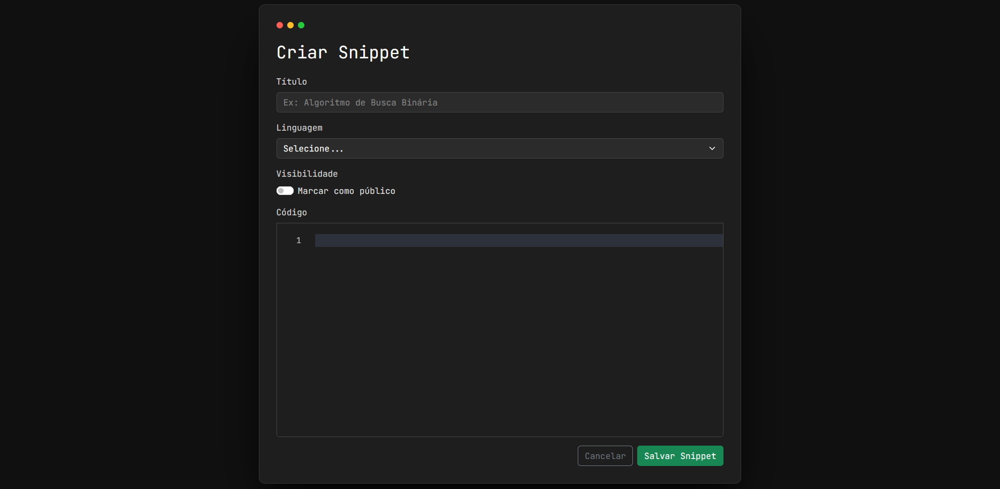
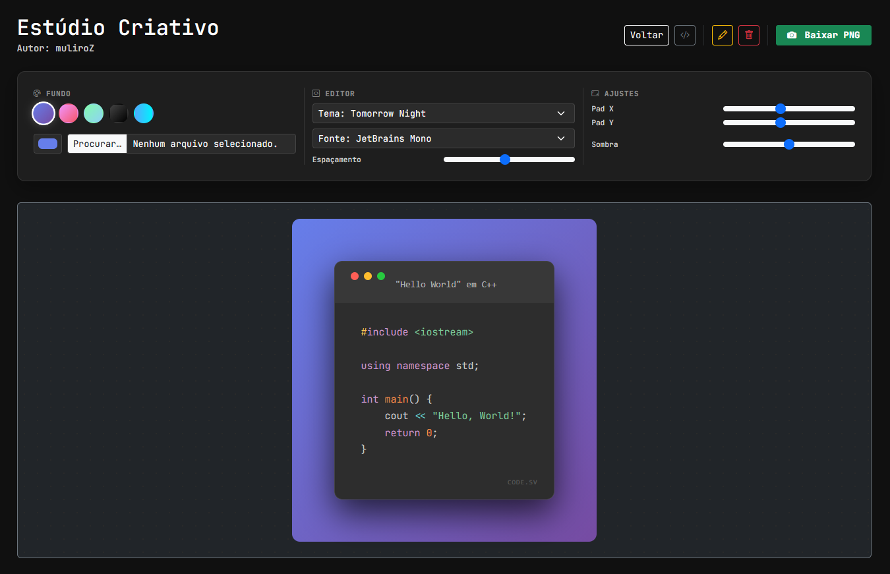

# CodeSV 💻


> **CodeSV** é uma plataforma moderna para armazenar, gerenciar e compartilhar trechos de código (snippets). Com foco na experiência do desenvolvedor, permite exportar códigos como imagens estéticas (estilo Carbon/Ray.so) e compartilhar conhecimentos com a comunidade.



---

## 🌐 Acesse o site

O projeto está ativo e rodando em produção! Acesse agora e crie seu primeiro snippet:

### 👉 **- [codesv.xyz](https://codesv.xyz) -**


> **Nota**: O domínio do site está correto, porém, o site encontra-se fora do ar, sem previsão para retorno. Caso retorne, avisarei por aqui.
> O código fonte está funcional para ser usado localmente, siga as instruções na seção [**Como Rodar o Projeto**](#-como-rodar-o-projeto) para configurar e executar a aplicação em sua máquina.

---

## ✨ Funcionalidades

- **🔐 Autenticação Social:** Login seguro e rápido via **GitHub OAuth2**.
- **📝 Editor Poderoso:** Integração com **Monaco Editor** (o mesmo do VS Code) para uma experiência de edição fluida.
- **🎨 Syntax Highlighting:** Suporte visual para múltiplas linguagens (Java, Python, JS, C++, SQL, etc.) usando **Prism.js**.
- **📸 Exportação para Redes Sociais:** Gere imagens PNG de alta resolução dos seus snippets com fundos gradientes e sombras 3D (estilo Carbon).
- **📥 Download de Código:** Baixe o arquivo fonte (`.java`, `.py`, etc.) diretamente do snippet.
- **🌍 Privacidade:** Escolha entre criar snippets **Públicos** (visíveis na comunidade) ou **Privados** (apenas para você).
- **🛡️ Segurança:** Proteção contra exclusão/edição não autorizada (apenas o dono pode gerenciar seus snippets).

---

## 🛠️ Tecnologias Utilizadas

### Backend
- **Java 21**: Linguagem base (LTS).
- **Spring Boot 3+**: Framework principal.
- **Spring Security (OAuth2 Client)**: Gerenciamento de autenticação e sessões via GitHub.
- **Spring Data JPA / Hibernate**: Persistência de dados.
- **Maven**: Gerenciador de dependências.

### Frontend
- **Thymeleaf**: Template engine para renderização server-side.
- **Bootstrap 5**: Framework CSS para layout responsivo.
- **Monaco Editor**: Editor de código web.
- **Prism.js**: Realce de sintaxe para visualização e exportação.
- **html2canvas**: Biblioteca para gerar screenshots do DOM.

### Infraestrutura & Banco de Dados
- **PostgreSQL**: Banco de dados relacional.
- **Docker & Docker Compose**: Containerização completa da aplicação e banco de dados.

---

## 🚀 Como Rodar o Projeto

### Pré-requisitos
- [Docker](https://www.docker.com/) e Docker Compose instalados.
- Uma conta no GitHub para criar as credenciais OAuth.

### 1. Clonar o Repositório
```bash
git clone https://github.com/muliroZ/CodeSV.git
cd CodeSV
```

### 2. Configurar Variáveis de Ambiente
> Crie um arquivo .env na raiz do projeto (baseado no exemplo abaixo). Você precisará gerar um Client ID e Client Secret no GitHub Developer Settings.

- **Conteúdo do arquivo .env:**
```dotenv
SERVER_PORT=8080

# Banco de Dados
DB_HOST=db
DB_NAME=codesvdb
DB_USER=postgres
DB_PASSWORD=sua_senha_segura

# Configuração Docker Postgres
POSTGRES_DB=codesvdb
POSTGRES_USER=postgres
POSTGRES_PASSWORD=sua_senha_segura

# GitHub OAuth2 (Obtenha no GitHub Developer Settings)
GITHUB_CLIENT_ID=seu_client_id_aqui
GITHUB_CLIENT_SECRET=seu_client_secret_aqui
```

### 3. Executar com Docker Compose
> Este comando irá compilar o projeto (usando Maven dentro do container), criar a imagem e subir o banco de dados.

```bash
docker compose up -d --build
```

Acesse a aplicação em: **http://localhost:8080**

---

# 📸 Telas

| Tela Inicial (Comunidade)                                 | Editor de Código                                               | View do Snippet                                                |
|-----------------------------------------------------------|----------------------------------------------------------------|----------------------------------------------------------------|
| Tela de Comunidade | Interface com Monaco Editor | Visualização Estilizada |

---

# 📂 Estrutura do Projeto
```plantuml
CodeSV/
├── src/
│   ├── main/
│   │   ├── java/com/muriloscorp/codesv/
│   │   │   ├── config/       # Configurações de Segurança
│   │   │   ├── controller/   # Endpoints Web
│   │   │   ├── dto/          # Objetos de Transferência de Dados
│   │   │   ├── model/        # Entidades JPA
│   │   │   ├── repository/   # Interfaces de Banco de Dados
│   │   │   ├── security/     # Lógica de Usuário OAuth2
│   │   │   └── service/      # Regras de Negócio
│   │   └── resources/
│   │       ├── static/       # CSS,, Images
│   │       └── templates/    # Views HTML (Thymeleaf)
├── Dockerfile                # Configuração da imagem Java (Ubuntu Jammy)
├── docker-compose.yml        # Orquestração (App + Postgres)
└── pom.xml                   # Dependências Maven
```

---

# 🤝 Contribuindo
> Contribuições são bem-vindas! Sinta-se à vontade para abrir Issues ou enviar Pull Requests.

    1. Faça um Fork do projeto.
    2. Crie uma Branch para sua Feature (git checkout -b feature/NovaFeature).
    3. Faça o Commit (git commit -m 'Add: Nova Feature').
    4. Faça o Push (git push origin feature/NovaFeature).
    5. Abra um Pull Request.

---

# 📄 Licença
### Este projeto está sob a licença [MIT](LICENSE).

---

<div>
    <small>Desenvolvido com ☕ e Java por <strong>muliroZ</strong>.</small> 
</div>